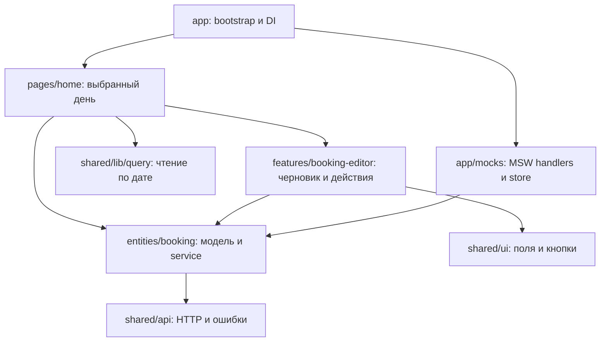
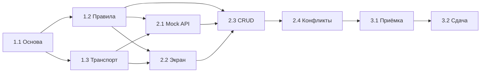
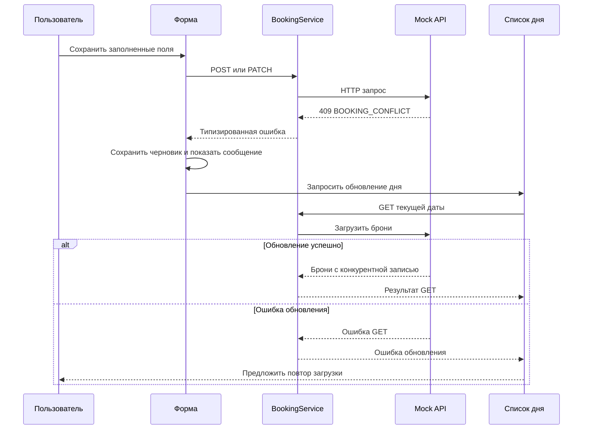
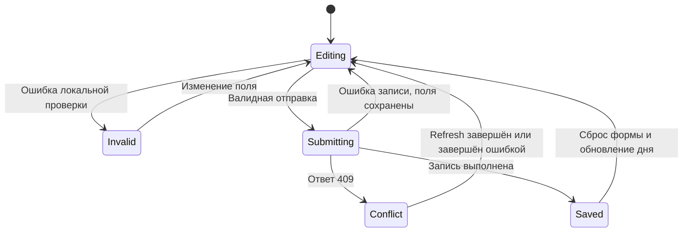

# План реализации: бронирование переговорной

Дата: 2026-10-29. Задача: тестовое задание без номера. Ветка: не создана, каталог пока не является Git-репозиторием.

Основание: задание и [актуальный PRD](./PRD.md). Выбор пользователя: `bun-fsd-template`; начавшиеся и прошедшие брони доступны только для просмотра. Этот документ — план, а не отчёт о выполнении. При расхождении ранних пунктов плана с PRD приоритет имеет PRD.

Актуальное архитектурное уточнение: управление расписанием реализуется машиной XState v5, редактирование существующей встречи — отдельной `meetingEditorMachine`. Координирующая машина владеет подтверждённым/оптимистическим расписанием, API и commit/rollback; редактор — original/draft и ошибками формы. Редактор вызывается на корневом уровне и сохраняет черновик при 409 и обновлении расписания. QueryStore не является вторым владельцем состояния бронирований. Подробный протокол и симуляционная модель: [day-schedule-simulation.md](./day-schedule-simulation.md). Это уточнение заменяет ранние пункты о reducer/query как владельцах бронирований; детальную переработку всего плана выполнить перед реализацией приложения.

## 📊 Дерево задач

### 1. Подготовить основу

- [ ] **1.1 Подготовить проект и базовую проверку** — зависимостей нет.
- [ ] **1.2 Определить модель брони и бизнес-правила** (dep: 1.1).
- [ ] **1.3 Расширить HTTP-клиент и запросы по дате** (dep: 1.1).

### 2. Реализовать API и интерфейс

- [ ] **2.1 Подключить mock API и хранилище** (dep: 1.2) (dep: 1.3).
- [ ] **2.2 Собрать экран выбранного дня** (dep: 1.2) (dep: 1.3).
- [ ] **2.3 Добавить создание, редактирование и удаление** (dep: 1.2) (dep: 2.1) (dep: 2.2).
- [ ] **2.4 Обработать конфликты и восстановление после ошибок** (dep: 2.3).

### 3. Проверить и подготовить сдачу

- [ ] **3.1 Проверить пользовательские сценарии и регрессии** (dep: 2.4).
- [ ] **3.2 Подготовить README, репозиторий и deployed demo** (dep: 3.1).

Обязательные правила и восстановление после `409` приоритетнее визуальной полировки.

## Решения и границы

- Одна комната, один экран, список броней по времени начала и форма рядом; на узком экране — вертикально. Начальная дата — сегодня.
- Использовать React + TypeScript + Bun из шаблона, существующие FSD, DI, Zod, Tailwind/shadcn и тестовые инструменты. Не добавлять Vite, Next.js, отдельный backend или новый state-менеджер.
- Дата и время локальные для браузера: `YYYY-MM-DD`, `HH:mm`; точность ввода — минута, без обязательного шага 30 минут. Не преобразовывать выбранную дату через UTC `toISOString()`.
- Продолжительность вычислять в минутах. Начало должно быть строго позже текущего момента: в момент начала бронь уже становится доступной только для просмотра. Часы передавать в проверки как зависимость; повторять проверку при отправке, возврате фокуса и обновлении текущего времени.
- Время начала и окончания, название — поля формы. Дата задаётся выбранным днём и при редактировании не меняется. При смене даты сбросить форму и закрыть редактирование; при ошибках запроса оставаться на той же дате и сохранять поля.
- Хранение в памяти одной вкладки, сброс после перезагрузки; синхронизация вкладок не входит в задачу. Авторизация, БД, повторяющиеся брони и выбор комнат исключены.
- Требования к сдаче включены в план; создание удалённого репозитория и публикация выполняются при реализации через доступный аккаунт. Пока аккаунт и адрес репозитория не выбраны, ссылки считаются неполученными.

## 📋 Функциональные требования

| ID | Требование | Источник | Приоритет |
| --- | --- | --- | --- |
| FR-001 | Выбирать дату; начальное значение — сегодня, пустое значение не запускает запрос | Задание; PRD | High |
| FR-002 | Отображать брони выбранной даты по возрастанию начала; при отсутствии — «На этот день бронирований нет» | Задание; PRD | High |
| FR-003 | Создавать бронь с началом, окончанием и необязательным названием | Задание | High |
| FR-004 | Редактировать будущую бронь с предварительным заполнением полей и отменой изменений | Задание; PRD | High |
| FR-005 | Удалять будущую бронь после подтверждения | Задание; PRD | High |
| FR-006 | Отклонять интервалы вне 09:00–18:00, с началом не раньше окончания или длительностью вне 30–120 минут включительно | Бизнес-правила 1–4 | High |
| FR-007 | Отклонять пересечения, разрешать касание границ, исключать текущую бронь при редактировании | Бизнес-правила 5 и 7 | High |
| FR-008 | Запрещать создание в прошлом; начавшиеся и прошедшие брони оставлять только для просмотра в UI и API | Бизнес-правило 6; ответ пользователя | High |
| FR-009 | При 409 сохранять поля формы, сообщать о занятости, повторно загружать брони; при неудаче обновления оставлять повтор загрузки | Бизнес-правило 8; PRD | High |
| FR-010 | Различать загрузку, пустой день, ошибку с повтором, отправку и ошибку операции; сохранять поля при ошибке сохранения | Задание; PRD | High |
| FR-011 | При смене даты сбрасывать форму; запоздавший ответ другого дня не должен попадать в текущий экран | PRD | High |
| FR-012 | Воспроизводить серверный конфликт для интервала, который UI считал свободным | PRD; демонстрация правила 8 | Medium |

High — обязательно для сдачи; Medium — демонстрационное удобство с меньшим приоритетом. Проверка `409` через тест обязательна независимо от наличия демонстрационного переключателя.

## 📋 Нефункциональные требования

| ID | Категория | Требование | Метрика |
| --- | --- | --- | --- |
| NFR-001 | Maintainability | Изолировать HTTP и mock от UI; соблюдать FSD и публичные API слайсов | Нет fetch в UI и импортов между слайсами одного слоя; замена API через DI |
| NFR-002 | TypeSafety | Проверять входные данные и ответы через Zod, сохранить строгий TypeScript | Успешный typecheck; нет обходов бизнес-типизации через any |
| NFR-003 | Accessibility | Обеспечить подписи, клавиатуру, связанный текст ошибок, объявления статуса и управление фокусом | CRUD доступен без мыши; ошибки связаны aria-describedby; статус через aria-live |
| NFR-004 | Compatibility | Адаптировать экран к мобильной и настольной ширине | Проверка 360 и 1280 px без горизонтальной прокрутки |
| NFR-005 | Reliability | Не допускать повторных мутаций и смешения данных разных дней | Один запрос при повторном нажатии; проверка обратного порядка ответов двух дат |
| NFR-006 | Delivery | Обеспечить воспроизводимые запуск, сборку, проверки и demo | check, build, e2e, ct; README с фактическими результатами и рабочая ссылка demo |

Проверка качества требований: источники и приоритеты обозначены; формулировки проверяемы; FR связаны со сценариями ниже. Дополнительные продуктовые решения вынесены в «Решения и границы». Проверка по десяти характеристикам skill выполнена вручную; автоматическая проверка оценивает структуру и формулировки, но не доказывает выполнение требований приложением.

## Исследование существующего кода

### Уровень 1: структура

| Область | Что существует | Изменение |
| --- | --- | --- |
| app | main, DI/query providers, TanStack Router, глобальные стили | Запуск MSW до рендера; локальный API; регистрация сервиса бронирований |
| pages/home | Демонстрационные карточки шаблона | Экран бронирования на существующем маршруте `/` |
| widgets | Header | Обновить название продукта, сохранить существующее переключение темы |
| features, entities | Пустые слои с .gitkeep | Добавить booking и booking-editor; не создавать пустые абстракции |
| shared/api | HttpClient с GET/POST, ApiError, tryRequest | PATCH, DELETE, 204 и типизированное тело ошибки |
| shared/lib | DI, QueryStore, Proxy и useServiceQuery | Параметризованные запросы по дате; отделение чтения от мутаций |
| shared/ui | Button, Input, Card, theme | Использовать текущие компоненты, добавить только необходимое подтверждение |
| scripts и тесты | Bun build/preview; unit, CT, E2E, CI | Раздача worker, новые проверки, замена проверок стартовых карточек |

### Уровень 2: подтверждённые связи

`app/main.tsx` оборачивает router в `AppProviders`; DI сейчас создаёт `FetchHttpClient` с внешним `jsonplaceholder` URL. `useServiceQuery` и `trackQueries` формируют ключ только из token и method; аргументы не учитываются. `QueryStore.run` дедуплицирует по этому ключу и преобразует исключение в `null`, сохраняя лишь текст ошибки. Это подходит для отображения состояния чтения, но теряет структурированный конфликт мутации.

HTTP-клиент всегда читает JSON после успешного запроса; без изменения `204` станет ошибкой. `tryRequest` уже сохраняет `ApiError` в канале ошибки `Result`; его можно использовать для мутаций без Proxy. Сборка обрабатывает только HTML-entrypoint и не копирует public assets. Browser MSW ещё не настроен. `bun run check` не включает E2E и CT — они запускаются отдельно в CI.

### Уровень 3: влияние и риски

| Изменение | Риск | Предотвращение и регрессия |
| --- | --- | --- |
| Ключ запроса с датой | Высокий: два дня дедуплицируются как один | Проверить аргументы, refetch и обратный порядок ответов; сохранить работу вызовов без аргументов |
| Мутации вне Proxy | Высокий: 409 превращается в null | Сохранить status/code в ApiError, обрабатывать через tryRequest; не дедуплицировать записи |
| Worker в dev/build | Высокий: HTML вместо JS, отсутствие mock в demo | Явный URL worker; проверка dev, preview и опубликованного домена |
| Проверки времени | Высокий: устаревшая доступность, UTC-сдвиг | Инъекция now, локальные даты, проверка при отправке и переходе дня |
| Обновление после 409 | Высокий: потеря формы при перемонтировании | Хранить черновик отдельно от состояния списка; проверить ошибку повторного GET |
| Замена home и header | Средний: старые E2E зависят от текста шаблона | Обновить home-spec, сохранить проверки темы и 404 |

## 🏗️ Архитектура изменений



Стрелки — направление зависимостей модулей. MSW перехватывает HTTP на границе транспорта; UI не импортирует mock. `app/mocks` использует чистые правила `entities/booking` для серверной проверки. Страница передаёт форме результат сохранения/обновления через явные callbacks, без импорта страницы из feature. Импорты между слайсами — через `@/…` и `index.ts`, внутри слайса — относительные.

### Контракт API

Модель `Booking`: строковые `id`, `date` в `YYYY-MM-DD`, `start/end` в `HH:mm`, необязательный `title`. Payload создания — модель без id. PATCH принимает изменяемые поля, объединяет их с текущей записью и проверяет итог целиком; UI передаёт начало, окончание и название текущего дня. Пропущенное название при PATCH сохраняется, пустая строка очищает его.

| Метод | Успех | Ошибки |
| --- | --- | --- |
| GET /api/bookings?date=YYYY-MM-DD | 200, Booking[] выбранного дня | 400 для неверной даты |
| POST /api/bookings | 201, Booking | 400 при нарушении правил, 409 при пересечении |
| PATCH /api/bookings/:id | 200, Booking | 400 при нарушении правил/запрете прошлого, 404, 409 |
| DELETE /api/bookings/:id | 204 без тела | 400 для начавшейся брони, 404 |

Ошибка: `code` и `message`. Коды: `VALIDATION_ERROR`, `BOOKING_NOT_FOUND`, `BOOKING_CONFLICT`. Непредвиденный/сетевой сбой показывать как ошибку операции с возможностью повтора, без очистки формы. Транспорт сохраняет status и code; при не-JSON ошибке сохраняет хотя бы status. После успешной мутации повторно получать текущий день; если обновление не удалось, явно сообщать, что запись выполнена, а список не обновлён, и повторять только GET.

Сервер повторно проверяет правила непосредственно перед изменением store, после искусственной задержки. Проверка пересечений и запись выполняются без ожидания между ними. Интервалы сравниваются только внутри одной даты. Для PATCH текущий id исключается. Для изменения/удаления сначала проверяется исходная бронь: перенос начавшейся брони в будущее не обходит запрет.

## 📋 Детализация по задачам

### 1. Подготовить основу

#### 1.1 Подготовить проект и базовую проверку

- Установить зависимости по lockfile при реализации; сохранить стек и версии шаблона, переименовать пакет под проект.
- Проверить исходные check/build; зафиксировать исходные проблемы отдельно от изменений задачи.
- Не менять локальную `.idea`; Git-репозиторий инициализировать для сдачи, не переносить историю шаблона.
- **Готово:** известен baseline, команды запуска воспроизводимы.

#### 1.2 Определить модель брони и бизнес-правила

- Описать Zod-схемы входных данных и DTO; выделить чистые проверки даты, времени, длительности, пересечений и доступности действий.
- Принимать текущее время явно; исключать текущий id только при редактировании существующей записи.
- Добавить unit-тесты границ, минутной точности, одинаковых интервалов разных дат и запрета прошлого.
- **Готово:** FR-006–008 проверяются без React и сети.

#### 1.3 Расширить HTTP-клиент и запросы по дате

- Добавить PATCH, DELETE и отдельный путь обработки успешного ответа без тела; сохранить GET/POST и валидацию ответов.
- Расширить ApiError кодом сервера; покрыть 400/404/409, не-JSON и сетевую ошибку.
- Научить query hook передавать аргументы, а ключ — включать их стабильное представление. Сохранить совместимость вызовов без аргументов.
- Отделить запросы чтения от мутаций: через Proxy проводить только чтение; CRUD выполнять через сервис и tryRequest.
- **Готово:** два дня имеют независимые состояния; refetch повторяет те же аргументы; 409 сохраняет структуру ошибки.

### 2. Реализовать API и интерфейс

#### 2.1 Подключить mock API и хранилище

- Реализовать HTTP handlers, in-memory store, повторную серверную валидацию и тестовые seed-данные относительно локального дня.
- Подготовить browser worker и запуск до первого запроса, включая production demo; при сбое bootstrap показывать ошибку запуска с повтором.
- Обеспечить отдельную раздачу `/mockServiceWorker.js` в Bun dev server и копирование worker в корень dist при build. Для dev добавить явный маршрут в Bun server, сохранив HTML-entrypoint, HMR и Tailwind.
- Подключить локальный BookingService через DI вместо внешнего API. Для unit-интеграций использовать MSW setupServer, для приложения — setupWorker.
- **Готово:** четыре endpoint работают через настоящий HTTP-клиент; worker в dev/preview возвращает JS, а не SPA HTML; mock включён в production.

#### 2.2 Собрать экран выбранного дня

- Заменить стартовые карточки на дату и список с названием, временем и доступными действиями; предусмотреть loading/empty/error/retry.
- Хранить выбранную дату отдельно от query; показывать только состояние её ключа. Невалидную/пустую дату не отправлять в API.
- Обновлять now каждые 30 секунд и при возврате фокуса; пересчитывать доступность при переходе дня, сохраняя явно выбранную дату.
- Проверить экран на 360 и 1280 px и при клавиатурной навигации.
- **Готово:** FR-001–002 и 011; прошлые брони видимы без действий изменения.

#### 2.3 Добавить создание, редактирование и удаление

- Создать одну форму для двух режимов; разделить черновик, ошибки полей, статус отправки и query-состояние списка.
- Выполнять локальную проверку при изменении полей и отправке; после обновления списка пересчитывать конфликт, не меняя введённых значений.
- В режиме редактирования предзаполнить поля; отменой вернуться к созданию. При смене даты сбросить режим и черновик.
- Перед удалением запросить подтверждение с фокусом на отмене; отмена не вызывает API. На время мутации блокировать повтор и переключение даты.
- При успешной записи сбросить форму и обновить день; при ошибке оставить черновик. После удаления вернуть фокус на доступный элемент списка или его заголовок.
- **Готово:** CRUD работает с API; обновление списка не перемонтирует и не очищает форму при ошибке.

#### 2.4 Обработать конфликты и восстановление после ошибок

- Для 409 показывать «Это время уже занято. Выберите другой интервал», затем обновлять выбранный день без очистки начала, окончания, названия и режима.
- Различать ошибку сохранения и ошибку последующего обновления списка; дать повтор загрузки независимо от сохранения формы.
- Для PATCH/DELETE с 404 сообщать об отсутствии записи и обновлять день; при PATCH сохранять черновик и предлагать явный переход к созданию, без автоматической повторной записи.
- Добавить выключенный по умолчанию блок «Демо API»: одноразовый конфликт следующего валидного POST/PATCH. Mock создаёт конкурентную запись этого же интервала и затем возвращает естественный 409; переключатель сбрасывается. Подключение — через DI demo-controller, без импортов app из UI и без изменения контракта bookings.
- **Готово:** FR-009 и 012 воспроизводимы; повторный GET с ошибкой не уничтожает черновик; двойное нажатие не создаёт две записи.

### 3. Проверить и подготовить сдачу

#### 3.1 Проверить пользовательские сценарии и регрессии

- Прогнать unit/integration таблицу ниже, Playwright CRUD, серверный конфликт, ошибку refresh и смену дат с обратным порядком ответов.
- Стабилизировать now и данные тестов; изолировать in-memory store между тестами. Для детерминированных сбоев использовать сетевые перехваты, отдельно проверить реальную связку browser MSW на preview.
- Обновить home E2E под продукт; сохранить проверки темы, неизвестного маршрута и существующего Button CT.
- Выполнить check, build, test:e2e и test:ct. Проверить клавиатуру, focus, aria-live, мобильную ширину и demo-сценарий на production preview.
- **Готово:** обязательные сценарии проходят; ограничения и непройденные проверки явно перечислены.

#### 3.2 Подготовить README, репозиторий и deployed demo

- Описать команды запуска/проверок, архитектуру, правила времени, сброс store, способ воспроизведения 409, сделанное/остаток и фактическое время.
- Приложить доступный экспорт переписки с AI; перед публикацией проверить отсутствие личных данных и секретов.
- Подготовить Git-репозиторий и статическое размещение на Vercel: build `bun run build`, output `dist`; worker раздавать как asset, неизвестные клиентские маршруты направлять на index.html.
- Проверить опубликованный URL: старт, worker, CRUD и конфликт. Указать реальную ссылку и фактический результат проверки; успешный build не считать успешным деплоем.
- **Готово:** получены ссылка репозитория, README, demo и переписка; при внешней блокировке указана конкретная недостающая часть.

## 🎯 Зависимости задач

Диаграмма показывает зависимости задач. После подготовки основы можно независимо прорабатывать бизнес-правила и транспорт; CRUD требует готовых правил, mock API и экрана. Приёмка выполняется после обработки ошибок, подготовка сдачи — после приёмки.



## Сценарии приёмки

Gherkin ниже описывает поведение для автоматизации; BDD-runner добавлять не требуется. Все даты сценариев фиксируются относительно тестовых часов.

```gherkin
# language: ru
@regress
Функционал: Просмотр выбранного дня
@regress
Сценарий: S-01 Открыть день без броней
  Допустим Установить локальные часы на 2026-10-29 08:00
  И Подготовить пустое хранилище на 2026-10-29
  Когда Открыть приложение
  То Отобразить выбранную дату 2026-10-29
  И Отобразить сообщение «На этот день бронирований нет»
```

```gherkin
# language: ru
@regress
Функционал: Создание и просмотр
@regress
Сценарий: S-02 Создать бронь будущего дня
  Допустим Установить локальные часы на 2026-10-29 08:00
  И Подготовить на 2026-10-30 бронь 12:00–13:00
  Когда Выбрать 2026-10-30 и сохранить 10:00–11:00 с названием «Планирование»
  То Отобразить новую бронь перед 12:00–13:00
  И Очистить форму после успеха
```

```gherkin
# language: ru
@regress
Функционал: Проверка интервала
@regress
Сценарий: S-03 Не отправлять невалидную форму
  Допустим Выбрать будущий день без броней
  Когда Указать интервал 09:00–09:29 и попытаться сохранить
  То Отобразить ошибку минимальной длительности
  И Не отправлять POST
```

```gherkin
# language: ru
@regress
Функционал: Редактирование
@regress
Сценарий: S-04 Исключать собственную бронь и разрешать касание
  Допустим Подготовить будущие брони A 10:00–11:00 и B 11:00–12:00
  Когда Открыть редактирование A и сохранить её без изменения времени
  То Сохранить A с прежним id
  И Не отобразить конфликт с A или B
```

```gherkin
# language: ru
@regress
Функционал: Удаление
@regress
Сценарий: S-05 Подтверждать удаление
  Допустим Подготовить будущую бронь A
  Когда Отменить первое подтверждение удаления и подтвердить второе
  То Отправить ровно один DELETE
  И Убрать A после успеха
```

```gherkin
# language: ru
@regress
Функционал: Доступность по времени
@regress
Сценарий: S-06 Запрещать прошедшее и начавшееся
  Допустим Установить локальные часы на 2026-10-29 10:15
  И Подготовить бронь A сегодня 10:00–11:00
  Когда Открыть сегодняшний день
  То Не предоставлять изменение и удаление A
  И Запретить создание интервала с началом 10:00
  И Отклонить прямую попытку API изменить или удалить A
```

```gherkin
# language: ru
@regress
Функционал: Серверный конфликт
@regress
Сценарий: S-07 Сохранить черновик при конкурентном бронировании
  Допустим Выбрать свободный будущий интервал 10:00–11:00
  И Заполнить название «Планирование»
  И Активировать одноразовый конфликт demo API
  Когда Сохранить бронь
  То Отобразить сообщение о занятости после 409
  И Повторно загрузить день с конкурентной бронью
  И Сохранить дату, время, название и режим формы
```

```gherkin
# language: ru
@regress
Функционал: Восстановление после ошибки
@regress
Сценарий: S-08 Повторять загрузку после неуспешного refresh
  Допустим Получить 409 при сохранении заполненной формы
  И Завершить следующий GET сетевой ошибкой
  Когда Нажать повтор загрузки после восстановления сети
  То Загрузить брони выбранного дня
  И Сохранить черновик на всех этапах
```

```gherkin
# language: ru
@regress
Функционал: Смена даты
@regress
Сценарий: S-09 Не показывать запоздавший ответ другого дня
  Допустим Заполнить форму дня A и задержать GET для A
  Когда Выбрать день B и получить его ответ раньше ответа A
  То Отобразить только брони B
  И Сбросить черновик и режим редактирования A
```

```gherkin
# language: ru
@regress
Функционал: Состояния запросов
@regress
Сценарий: S-10 Обрабатывать ожидание и повтор без дублирования
  Допустим Задержать GET выбранного дня и затем вернуть ошибку
  Когда Повторить загрузку успешно и дважды нажать сохранение заполненной формы
  То Отобразить загрузку, затем ошибку с повтором, затем данные
  И Отправить только один POST во время отправки
```

| Требования | Сценарии | Дополнительное покрытие |
| --- | --- | --- |
| FR-001–002 | S-01, S-02 | Пустая дата; сортировка; список прошлой даты |
| FR-003 | S-02, S-10 | Успех записи с неуспешным refresh |
| FR-004 | S-04 | Отмена; редактирование в занятый интервал; PATCH 404 |
| FR-005 | S-05 | DELETE 404/500 и сохранение записи в UI при ошибке |
| FR-006 | S-03 | Таблица UT: рабочий день, порядок, длительности |
| FR-007 | S-04, S-07 | Вложенные интервалы, равенство, разные даты |
| FR-008 | S-06 | Вчера; момент начала; время наступило во время заполнения |
| FR-009 | S-07, S-08 | Те же проверки для PATCH, а не только POST |
| FR-010 | S-01, S-08, S-10 | 400/404/500, сетевой сбой, bootstrap error |
| FR-011 | S-09 | Обратный порядок ответов и refetch текущей даты |
| FR-012 | S-07 | Production preview с реальным worker |

### Последовательность обработки 409



## 🧪 Unit тесты

Фиксировать now как локальное 2026-10-29 08:00, если не указано иное. Чистые правила и HTTP-интеграции — Bun; отображение и взаимодействия — Playwright CT/E2E, а не искусственные unit-тесты React.

| ID | Название теста | Входные параметры | Ожидаемый результат |
| --- | --- | --- | --- |
| UT-001 | Границы рабочего дня | Завтра: 08:59–09:30; 09:00–09:30; 17:30–18:00; 17:30–18:01 | Ошибка; успех; успех; ошибка |
| UT-002 | Порядок времени | Завтра: 10:00–10:00; 11:00–10:00 | Ошибка порядка для обоих |
| UT-003 | Минимум | Завтра: 10:00–10:29; 10:00–10:30 | Ошибка; успех |
| UT-004 | Максимум | Завтра: 10:00–12:00; 10:00–12:01 | Успех; ошибка |
| UT-005 | Пересечение и вложение | Есть A 10:00–11:00; новые 09:30–10:30, 10:15–10:45, 09:30–11:30 | Конфликт для каждого |
| UT-006 | Касание | Есть 10:00–11:00; новые 09:30–10:00 и 11:00–11:30 | Оба допустимы |
| UT-007 | Self exclusion | Есть A 10:00–11:00; PATCH A с тем же временем | Успех; другая бронь с тем же временем конфликтует |
| UT-008 | Разные дни | Есть завтра 10:00–11:00; новый послезавтра 10:00–11:00 | Успех |
| UT-009 | Прошлая дата | now 29 октября; POST 28 октября 12:00–13:00 | Ошибка прошлого |
| UT-010 | Прошедший слот сегодня | now 10:15; сегодня 10:00–11:00 и 10:16–11:00 | Ошибка; успех |
| UT-011 | Начало наступило | now 10:00; A сегодня 10:00–11:00; PATCH или DELETE A | 400, исходная запись без изменений |
| UT-012 | Время прошло во время ввода | Заполнение при 09:59, отправка при 10:01, начало 10:00 | Отклонение при отправке в UI и API |
| UT-013 | Формат | Дата 2026-02-30; время 9:0; отсутствующий start | 400 без изменения store |
| UT-014 | Частичное изменение | A 10:00–11:00; PATCH end=10:20 | 400 после объединения с текущей записью |
| UT-015 | Удаление без тела | DELETE будущего id, ответ 204 | Успех без response.json |
| UT-016 | Ошибки транспорта | Ответ 409 с code; 500 без JSON; network reject | ApiError со status/code при наличии, различимые ошибки |
| UT-017 | Независимые query | GET дат A и B одновременно, B отвечает первым | Два запроса, данные привязаны к своим ключам |
| UT-018 | Refetch и дедупликация | Два GET даты A одновременно; затем refetch A | Один первый HTTP, следующий HTTP повторяет A |
| UT-019 | Сохранение ошибки мутации | POST/PATCH получает 409 | Result с ApiError, не null; нет query-дедупликации мутаций |
| UT-020 | Конкурентные записи | Два POST одного будущего интервала | Один 201, один 409, одна запись в store |
| UT-021 | Нет записи | PATCH/DELETE отсутствующего id | 404 BOOKING_NOT_FOUND |

## 🎭 Диаграмма состояний

Состояния формы независимы от загрузки списка: повторный GET не очищает черновик. Имена перечислены концептуально; библиотеку конечных автоматов вводить не требуется.



## Проверка плана и Definition of Done

- Документ создан по `todo-plan-generator` v8.4.0. Интервью и выбор решений взяты из состоявшейся переписки; PRD не расширяется новым продуктом.
- Отклонение от стандартного пути skill: файл находится в `docs` по прямому запросу пользователя; дубликат в `plan` не создаётся.
- Исследование и сценарии проверены параллельно тремя агентами вместо четырёх из-за лимита доступных слотов; L1 и L2 объединены. Итог агрегирован в одном файле.
- Автоматические проверки документа: общий validator — без ошибок, с ложным предупреждением о названиях состояний; Mermaid validator — без ошибок; Gherkin validator — без ошибок, с предупреждениями о тегах и окружающем Markdown. Эти проверки не являются прогоном тестов приложения.
- Валидатор FR/NFR из skill не запускается: SyntaxError в его `requirements-decomposer/scripts/validate.py:352`. Требования проверены вручную; файл skill не изменялся. Зависимости задач проверены на отсутствие циклов.
- Готовность приложения означает выполнение FR High, NFR, check/build/E2E/CT и проверку реального demo. Незавершённые пункты не помечать выполненными; остаток и затраты времени записать в README.
- Планирование не включает реализацию, установку зависимостей, создание репозитория, публикацию или новые коммиты.
